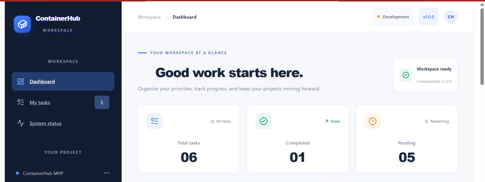
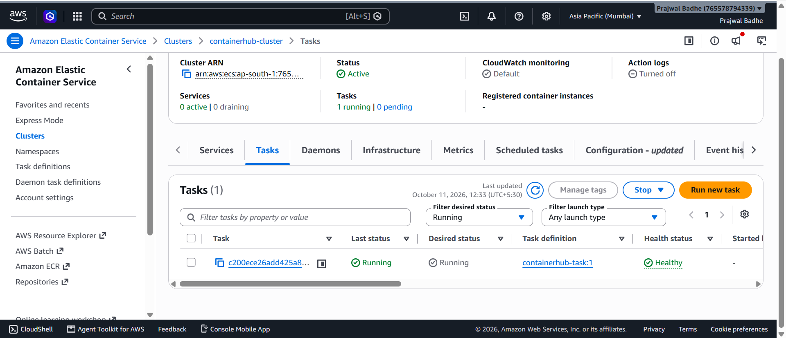
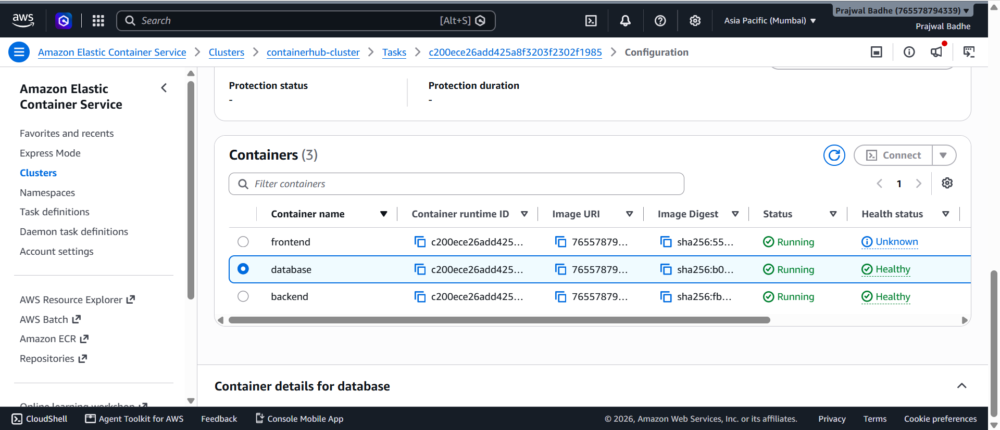
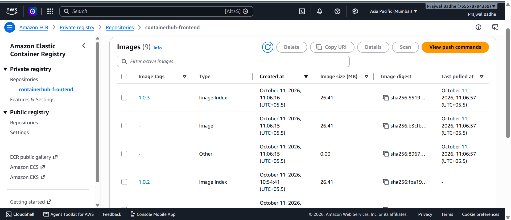
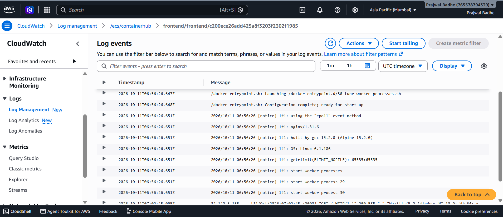

# 🚀 ContainerHub
### Containerized Task Management Application on AWS

<p align="center">
  <strong>React • Node.js • PostgreSQL • Docker • Amazon ECS Fargate</strong>
</p>

<p align="center">
  
  
  
  
  
</p>

---

## 📌 Table of Contents

- [Project Overview](#-project-overview)
- [Architecture](#-architecture)
- [Technology Stack](#-technology-stack)
- [Application Features](#-application-features)
- [API Endpoints](#-api-endpoints)
- [Amazon ECR Images](#-amazon-ecr-images)
- [Local Development](#-local-development)
- [AWS Deployment](#-aws-deployment)
- [Security](#-security)
- [Database Storage and Availability](#-database-storage-and-availability)
- [Screenshots](#-screenshots)
- [Cost Management](#-cost-management)
- [Future Enhancements](#-future-enhancements)
- [Repository](#-repository)

---

## 📌 Project Overview

**ContainerHub** is a full-stack task management application built with React, Node.js, Express.js, and PostgreSQL.

The project demonstrates how to containerize a multi-tier application with Docker and deploy it to Amazon ECS Fargate. It includes container image management, health checks, secure database credentials, AWS networking, and centralized logging.

### 🎯 Project Objectives

- 🐳 Containerize the frontend, backend, and database.
- 📦 Store Docker images in Amazon Elastic Container Registry (ECR).
- ☁️ Deploy the application using Amazon ECS Fargate.
- 🔐 Manage database credentials using AWS Systems Manager Parameter Store.
- 📊 Collect container logs using Amazon CloudWatch Logs.
- 🩺 Configure container health checks and startup dependencies.
- 🌐 Expose the frontend without an Application Load Balancer.
- 💰 Stop the standalone Fargate task after testing to reduce ongoing compute usage.

### 📍 Deployment Information

| Setting | Value |
|---|---|
| Project Name | ContainerHub |
| AWS Region | `ap-south-1` — Mumbai |
| ECS Cluster | `containerhub-cluster` |
| Task Definition | `containerhub-task:1` |
| Launch Type | AWS Fargate |
| Network Mode | `awsvpc` |
| Deployment Model | Standalone task |
| Application Protocol | HTTP |
| Load Balancer | Not used |

---

## 🏗️ Architecture

```text
                         👤 User
                            |
                         HTTP :80
                            |
                            v
                 +----------------------+
                 |   React Frontend    |
                 |   Nginx Web Server  |
                 +----------------------+
                            |
                          /api/*
                            |
                            v
                 +----------------------+
                 |   Node.js Backend   |
                 |   Express REST API  |
                 +----------------------+
                            |
                      localhost:5432
                            |
                            v
                 +----------------------+
                 |  PostgreSQL Database|
                 +----------------------+

                   AWS ECS Fargate
              One task, three containers
                 Shared task network

   GitHub --> Docker Build --> Amazon ECR --> ECS Fargate

   AWS Systems Manager --> Database credentials
   Amazon CloudWatch    --> Container logs
```

### 🔄 Deployment Workflow

| Step | Technology | Purpose |
|---:|---|---|
| 1 | Git and GitHub | Source code management |
| 2 | Docker | Build application images |
| 3 | Amazon ECR | Store container images |
| 4 | Amazon ECS Fargate | Run the containers |
| 5 | AWS IAM | Provide task execution permissions |
| 6 | Systems Manager Parameter Store | Supply database credentials |
| 7 | Amazon CloudWatch Logs | Collect container logs |

---

## 🛠️ Technology Stack

| Category | Technology |
|---|---|
| 🎨 Frontend | React, Vite, Nginx |
| ⚙️ Backend | Node.js, Express.js |
| 🗄️ Database | PostgreSQL |
| 🐳 Containerization | Docker, Docker Compose |
| 📦 Container Registry | Amazon ECR |
| ☁️ Orchestration | Amazon ECS Fargate |
| 🔐 Access Control | AWS IAM |
| 🔑 Secret Management | AWS Systems Manager Parameter Store |
| 📊 Logging | Amazon CloudWatch Logs |
| 🌐 Networking | Amazon VPC, Subnets, Security Groups |
| 💻 Command Line | AWS CLI |
| 🔗 Version Control | Git, GitHub |

---

## ✨ Application Features

- 📋 Task management dashboard.
- 🔌 REST API for retrieving task records.
- 🗄️ PostgreSQL-backed task storage.
- 📦 Separate frontend, backend, and database containers.
- 🩺 PostgreSQL and Node.js backend health checks.
- 🔒 Secure database password injection through Parameter Store.
- 📊 Centralized container logging.
- 🌐 Public HTTP access to the frontend.
- 🚫 No Application Load Balancer required for the demonstration.
- 🧪 Live deployment and API testing.

---

## 🔌 API Endpoints

| Method | Endpoint | Description |
|---|---|---|
| `GET` | `/api/health` | Check backend health |
| `GET` | `/api/tasks` | Retrieve task records |

### ✅ Verified API Response

The deployed `/api/tasks` endpoint returned task data successfully.

Example response structure:

```json
{
  "success": true,
  "count": 1,
  "data": [
    {
      "id": 1,
      "title": "docker",
      "category": "General",
      "priority": "Medium",
      "completed": true
    }
  ]
}
```

*Example based on the successful deployment test. The actual task data may change.*

### 🧪 Deployment Test Results

| Test | Result |
|---|---|
| Frontend dashboard | ✅ Passed |
| Backend health check | ✅ Healthy |
| PostgreSQL health check | ✅ Healthy |
| Tasks REST API | ✅ Passed |
| Database task retrieval | ✅ Passed |
| Fargate task shutdown | ✅ Completed |

---

## 📦 Amazon ECR Images

**AWS Region:** `ap-south-1` — Asia Pacific (Mumbai)

| Repository | Image Tag | Purpose |
|---|---|---|
| `containerhub-frontend` | `1.0.3` | React application served by Nginx |
| `containerhub-backend` | `1.0.2` | Node.js REST API |
| `containerhub-database` | `17-alpine-2` | PostgreSQL with initialization SQL |

**ECR registry:**

```text
765578794339.dkr.ecr.ap-south-1.amazonaws.com
```

---

## 🚀 Local Development

### 📋 Prerequisites

- Git
- Docker Desktop
- Docker Compose
- Node.js and npm for development outside containers

### 1️⃣ Clone the repository

```bash
git clone https://github.com/prajwalbadhe12-oss/ContainerHub.git
cd ContainerHub
```

### 2️⃣ Configure environment variables

Create or configure your local `.env` file using the variable names expected by the project.

**Security reminder:** Never commit real database passwords, AWS credentials, access keys, or other secrets to GitHub. Ensure `.env` is excluded by `.gitignore`.

### 3️⃣ Build and start the application

```bash
docker compose up --build -d
```

### 4️⃣ Check running containers

```bash
docker compose ps
```

### 5️⃣ Review application logs

```bash
docker compose logs
```

### 6️⃣ Stop the local application

```bash
docker compose down
```

This command stops and removes Compose containers and networks. It does not request deletion of named volumes.

> **Note:** Use the actual ports configured in `docker-compose.yml` to access your local dashboard and API.

---

## ☁️ AWS Deployment

### ⚙️ Deployment Configuration

| Setting | Value |
|---|---|
| AWS Region | `ap-south-1` |
| ECS Cluster | `containerhub-cluster` |
| Task Definition | `containerhub-task:1` |
| CPU | 1 vCPU |
| Memory | 3 GB |
| Operating System | Linux |
| Architecture | X86_64 |
| Network Mode | `awsvpc` |
| Frontend Port | `80` |
| Backend Port | `3000` |
| PostgreSQL Port | `5432` |
| Load Balancer | Not used |

### 🔄 Deployment Steps Completed

1. Built Docker images for the frontend, backend, and database.
2. Published the images to Amazon ECR.
3. Configured the ECS task execution role.
4. Stored the database password as a SecureString in Systems Manager Parameter Store.
5. Configured the CloudWatch log group `/ecs/containerhub`.
6. Registered ECS task definition revision `1`.
7. Configured VPC networking, public subnet selection, and security group rules.
8. Launched a standalone ECS Fargate task.
9. Verified the dashboard and REST API.
10. Confirmed that the database and backend became healthy.
11. Stopped the standalone task after testing.
12. Verified that no tasks were desired to be running and no ECS services existed in the cluster.

### 📊 Final Deployment Status

| Resource | Final Status |
|---|---|
| ECS Cluster | `ACTIVE` |
| Task Definition | `ACTIVE` |
| Standalone Task | `STOPPED` |
| Running Tasks | `0` |
| ECS Services | `0` |
| ECR Images | Retained |
| CloudWatch Log Group | Retained |

The application was successfully tested during the deployment session. It is **not currently running** because the Fargate task has been stopped.

---

## 🔐 Security

- 🔑 Database credentials are supplied through Systems Manager Parameter Store.
- 🛡️ IAM permissions are scoped to the required database password parameter.
- 🌐 Public inbound traffic is restricted to frontend port `80`.
- 🚫 Backend port `3000` and PostgreSQL port `5432` are not publicly exposed.
- 🙈 Local `.env` files containing secrets must remain excluded from Git.

### ⚠️ Production Considerations

This project is a demonstration deployment and does not implement every production requirement.

Recommended production improvements include:

- HTTPS with a valid TLS certificate.
- Persistent database storage and automated backups.
- Database password rotation and stronger secret lifecycle management.
- Automated recovery and availability controls.
- Frontend health checks.
- Least-privilege IAM permissions and appropriate monitoring.

---

## 💾 Database Storage and Availability

The PostgreSQL container uses temporary container storage rather than a persistent managed database.

Consequently:

- Database contents may be lost when the task is replaced.
- Stopping or replacing the task should not be treated as a database backup strategy.
- The deployment does not provide automatic recovery or high availability.
- No Amazon RDS database is used.

---

## 📸 Screenshots

The `Screenshots/` directory contains the visual evidence for the project. Add the corresponding image files using the filenames below to display them on GitHub.

### 🖥️ 1. Application Dashboard



### ☁️ 2. ECS Task Details



### 🩺 3. Container Health Checks



### 📦 4. Amazon ECR Images



### 📊 5. Amazon CloudWatch Logs



> **Important:** These image links will render only when the corresponding files exist in the `Screenshots/` directory and are committed to the repository. Do not add placeholder files with these names unless they contain the actual screenshots.

---

## 💰 Cost Management

- The standalone Fargate task was stopped after testing.
- No ECS service was created.
- No Application Load Balancer was used for this deployment.
- ECR image storage, CloudWatch Logs, Parameter Store, public IPv4 usage while allocated, and other retained AWS resources may incur charges depending on usage and applicable allowances.

Stopping the Fargate task reduces ongoing compute usage but does not guarantee that all AWS charges are zero.

Review AWS billing and resource usage periodically.

---

## 🚧 Future Enhancements

- [ ] Automated CI/CD using GitHub Actions.
- [ ] HTTPS and custom domain configuration.
- [ ] Persistent database storage and automated backups.
- [ ] Frontend health checks.
- [ ] Automated tests in the build pipeline.
- [ ] Infrastructure as Code using Terraform or AWS CloudFormation.
- [ ] Production-ready secret rotation.
- [ ] Enhanced observability and availability controls.

---

## 🔗 Repository

**GitHub:** [ContainerHub](https://github.com/prajwalbadhe12-oss/ContainerHub)

---

## 📌 Project Status

**Deployment tested successfully.**

The ContainerHub application was deployed on Amazon ECS Fargate, verified through the dashboard and REST API, and stopped after testing. The task definition and ECR images remain available for a future deployment.

